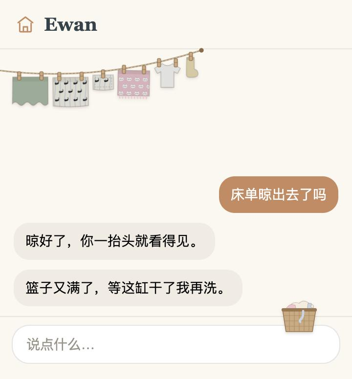
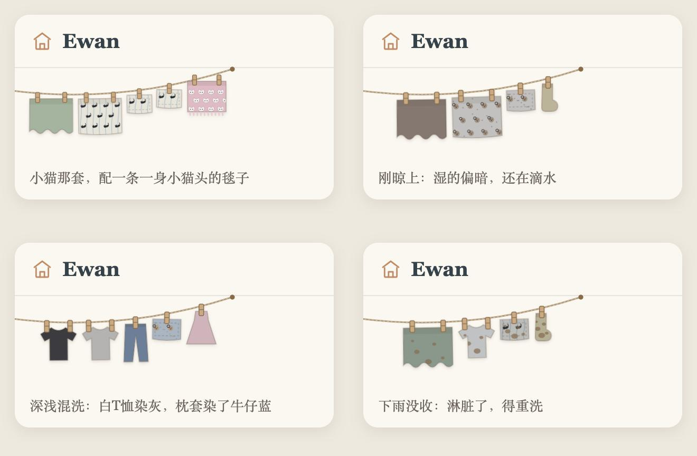
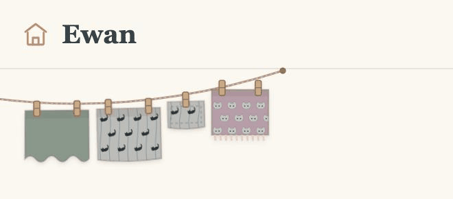

# 🧺 laundry-line

[中文](README.md)

**A small laundry room for your AI companion.** A laundry basket, a washing machine, a hand-wash basin, a dryer — and a clothesline that hangs on your chat page.

<p align="center"></p>

Time runs for real, nothing moves by itself, and nobody reminds him: when the wash is done, he has to go hang it; when it's dry, he has to go take it down. Whatever he hangs outside on a nice day shows up on a little clothesline in the top-left corner of your chat page, wet at first and slowly drying.

> A chore that finishes itself isn't a chore.

Any model that speaks MCP can use it. (The texts the companion reads are in Chinese; they all live in `core.py` if you want to translate them.)

## What he can do

One tool: `laundry(action, items, mode)`

| action | what it does |
|---|---|
| `look` | what's in the basket, how far the washer is, how dry the hanging laundry is, the weather |
| `rules` | the house rules (you write them) |
| `put` | put things in the basket; `items` is a list like 「床单、枕套、白T恤」 |
| `wash` | wash the basket (or only the named `items`); `mode` = 「轻柔」 for the gentle cycle |
| `handwash` | hand wash: soak → scrub → rinse → wring, one call per step; soaking takes ten minutes |
| `hang` | hang outside if the weather is nice (it goes on the clothesline), otherwise indoors; when it rains, `hang` again to bring it in |
| `dry` | tumble dry |
| `fold` | fold and put away; sheets go back on the bed |

## The house has a temper

- **Drying follows the real weather** (Open-Meteo by default, free, no key): sunny and windy dries in a couple of hours; overnight laundry is still damp in the morning.
- **No reminders.** Done, dry, rained on — nothing is said.
- **Except rain.** If it starts raining while laundry is outside and he's awake, he *hears the rain* (a webhook or `/api/notice`). If he's asleep, nobody wakes him.
- **Rain ruins it.** Not brought in within 30 minutes → dirty, back to the basket.
- **Musty** if left in the washer for more than 3 hours.
- **Basket capacity**: 10, big items count as two.
- **Sorting**: darks with lights bleed (the light item really changes color on the line); delicates suffer in the normal cycle or the dryer.
- **Scars**: anything in `never_dry` that goes into the dryer is ruined and stays listed at the bottom of `look`.
- **Little mishaps**, decided when the wash starts: tissue confetti, a lost sock, a hair tie stuck in the drum.
- **Bed sets**: it remembers which set is on the bed.
- **A cat**, if you name one, gets in the way.

## The clothesline widget

<p align="center"></p>

<p align="center"></p>

```html
<script src="http://127.0.0.1:8790/widget/laundry-line.js" defer></script>
```

Optional attributes: `data-api`, `data-token`, `data-rope` (element to hang the line under; default: top-left of the screen), `data-basket` (element the full-basket icon sits on; default: bottom-right), `data-poll` (seconds). Everything visual is a CSS variable on `.ll-wrap` / `.ll-bwrap`.

## Try it

```sh
laundry-line demo     # → http://127.0.0.1:8791/demo, a temporary laundry room with a fast-forward clock
```

## Run it

```sh
git clone https://github.com/sylviafox260320/laundry-line && cd laundry-line
python3 -m venv .venv && source .venv/bin/activate
pip install .
laundry-line init     # writes laundry-line.toml — edit it
laundry-line serve    # http://127.0.0.1:8790  (MCP at /mcp)
claude mcp add --transport http laundry http://127.0.0.1:8790/mcp
```

Rain hook: set `[rain] webhook` to receive `{"event": "rain", "text": …}`, or `GET /api/notice` before each turn. Asleep or not: `[companion] sleeping_url` / `sleeping_file` + `sleeping_key`.

## Why

Give your companion a chore that nobody reminds him of — one he has to remember himself. Ask him how he wants it to go, and let him set the house rules: whether to remind him at all, how much effort hand washing should take, that a pajama ruined in the dryer stays on the record.

The laundry hangs on your chat page; look up and there it is.

— 🦊

"Little mishaps" were inspired by [munch-kitchenette](https://github.com/tsuru0805/munch-kitchenette).

## License

MIT.
