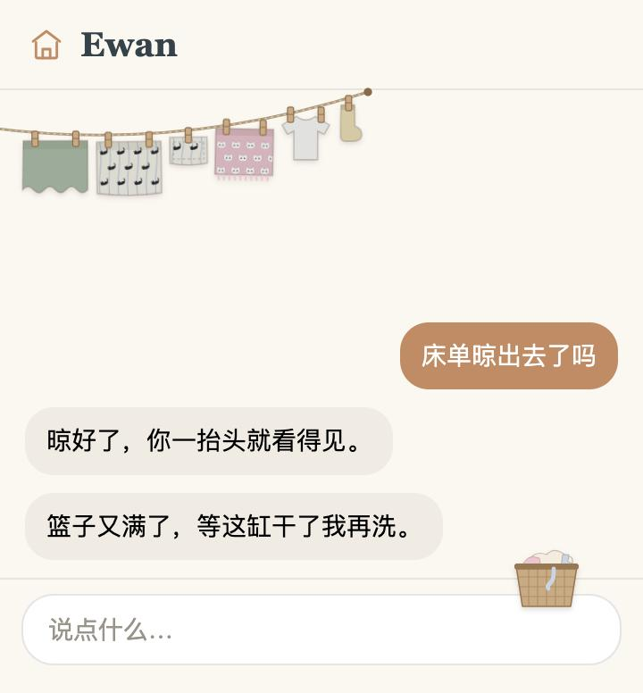
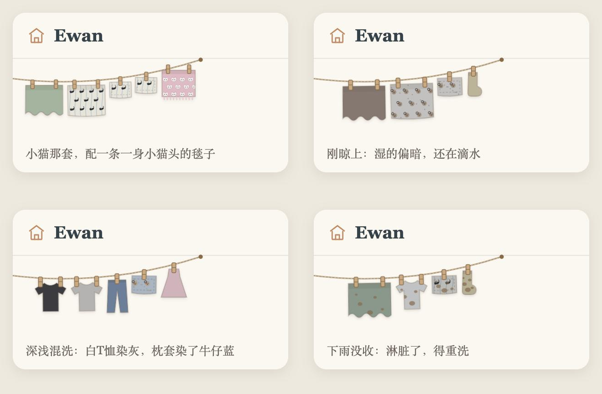
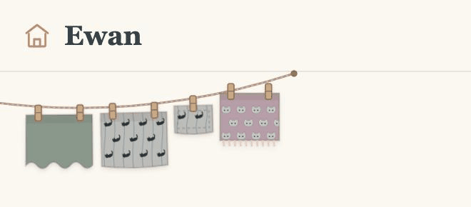
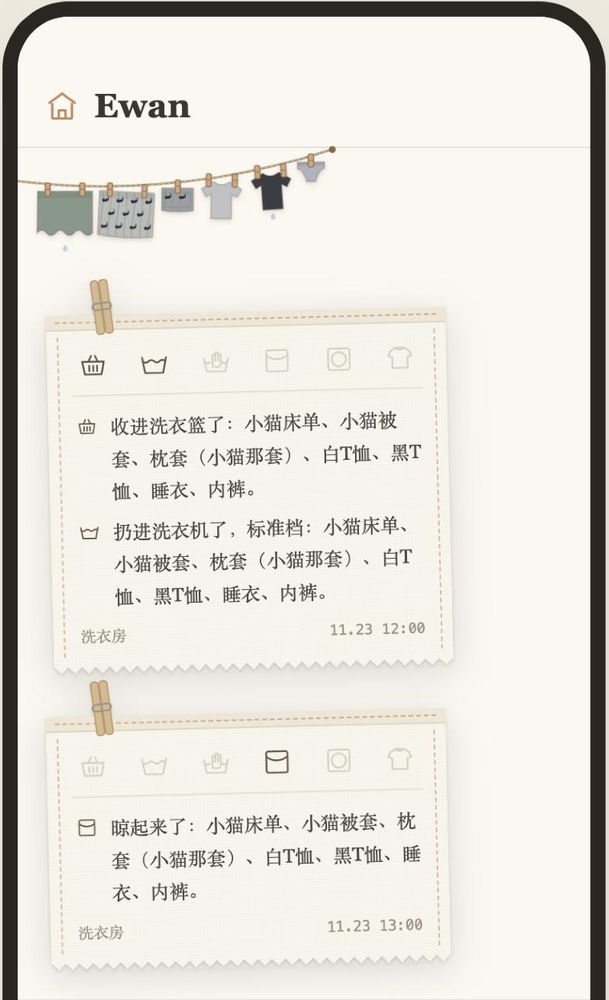

# 🧺 laundry-line（晾衣绳）

[English](README.en.md)

**给你的小机一间洗衣房。** 洗衣篮、洗衣机、手洗盆、烘干机，还有一根挂在你聊天页上的晾衣绳。

<p align="center"></p>

时间按真的走，东西不会自己挪，也没人提醒他：洗好了得他自己去晾，晾干了得他自己去收。天好晾出去的衣服，就挂在你聊天页左上角那根绳子上，刚晾上是湿的，慢慢一点点变干；你一抬头就看得见。

> 一按就好的活儿不算活儿。

任何支持 MCP 的模型都能连上来用。

---

## 他能做什么

只有一个工具 `laundry(action, items, mode)`：

| action | 做什么 |
|---|---|
| `look` | 看一眼：篮子里有什么、洗衣机转到哪儿了、晾着的干了几成、外面什么天 |
| `rules` | 屋里的规矩（你写的，见下面「设置」） |
| `put` | 收进洗衣篮。`items` 写收了什么，顿号隔开：「床单、枕套、白T恤」 |
| `wash` | 洗。`items` 不写＝篮子里全洗；写了就只洗那几件。`mode` 写「轻柔」走轻柔档 |
| `handwash` | 手洗：泡、搓、冲、拧，**一步调一次**，泡要等十分钟 |
| `hang` | 晾：天好晾外面（上绳），不好晾屋里；`mode` 写「屋里」就晾屋里。下雨了再 `hang` 一次，把外面的收进屋 |
| `dry` | 烘干。`items` 不写＝洗好的那批全进（洗衣机空着就是晾着还没干的）；写了就只烘那几件，没点到的留在原地 |
| `fold` | 收下来叠好，床单被套铺回床上 |

## 这间屋子的脾气

- **晾干跟着真天气走。** 每隔几分钟按当时的天、风、湿度、气温往前晾一点：晴天有风两个多小时，阴天潮天慢，夜里晾出去到早上还是半干。天气默认从 [Open-Meteo](https://open-meteo.com/) 取（免费、不用注册），填你的经纬度就行。
- **不提醒。** 洗好、烘好、晾干、淋脏，一句都不说。
- **只有下雨会让他知道。** 下起来那会儿外面挂着东西、他又醒着，他会「听见雨」——只是一句雨声，不提衣服。他睡着了就不叫。
- **下雨不收会淋脏。** 下雨后 30 分钟内不收进屋，晾在外面的就脏了，得扔回篮子重洗。
- **闷久了有味。** 洗好闷在洗衣机里超过 3 小时，有股闷味，晾干了也带着。
- **篮子有上限。** 10 件，床单被套毯子这种大件算两件；满了塞不进去，得先洗一批。
- **分缸。** 深的浅的混着洗会串色——绳子上那件真的会变灰、变灰蓝、变粉。娇气的（睡衣、丝的、毛衣）进了标准档、进了烘干机都会出事。
- **长记性。** 你在设置里写进 `never_dry` 的东西，进了烘干机就是大事故：一定出事，而且一直挂在 `look` 最底下，记着哪天、哪件。
- **小意外。** 偶尔口袋里忘了掏纸巾，满滚筒纸屑；滚筒缝里卡着一根发圈；少了一只袜子……开洗那一刻就定了，不改结果，只多一句画面。
- **四件套。** 你家有几套床品，设置里写上；床单被套铺回床上时，它记得现在床上是哪套，下回从床上扒下来没写哪套，就认是床上那套。
- **家里的猫。** 设置里写上猫的名字，它会来捣乱：往篮子里探头、蹲在盆边看水、趴在刚烘好还热乎的床单上不肯走。

## 晾衣绳小组件

<p align="center"></p>

<p align="center"><br><sub>晾干跟着真天气走：刚晾上偏暗，干了几成就浅几成</sub></p>

一行挂到你的聊天页上：

```html
<script src="http://127.0.0.1:8790/widget/laundry-line.js" defer></script>
```

- 天好晾出去的那几缸挂在绳子上，每缸随机挂 5～7 件（挑中哪几件是定死的，不会一刷新就换）
- 按名字认形状：床单、被套、枕套、毯子、毛巾、袜子、内裤、内衣、T恤、裤子、裙子……名字里写了颜色（黑、白、牛仔、粉……）就照颜色画
- 湿的偏暗还会滴水，干了几成就浅几成；淋脏了带泥点；串了色的那件真的变色
- 点衣服掉下一张小纸条：晾的是什么、干了几成、大概几点干
- 洗衣篮满了，聊天框上会坐一个装满的小篮子，隔几秒晃一下
- 夜间（`<html data-theme="dark">`）自动暗一档

可选参数（写在同一个 `<script>` 标签上）：

| 参数 | 意思 |
|---|---|
| `data-api` | 数据从哪儿取，默认就是这个脚本的来源 |
| `data-token` | 服务设了 token 时带上 |
| `data-rope=".chat-header"` | 绳子挂在哪个元素的下沿；不写就贴在屏幕左上角 |
| `data-basket="#input-bar"` | 满篮子坐在哪个元素的右上角；不写就贴在屏幕右下角 |
| `data-poll="300"` | 多少秒取一次数据 |

颜色、尺寸都是 CSS 变量（`.ll-wrap` 上的 `--ll-w`、`--ll-drop`、`--ll-scale`、`--ll-min`、`--ll-max`……），在你自己的样式里盖掉就行。`--ll-drop` 是负数时，靠屏幕边那头往下斜出去。

## 洗标

<p align="center"></p>

他调 `laundry` 干活的时候，你的聊天页可以不画成一行工具调用，而是一张衣服上的洗标：顶上一排洗涤符号（洗衣篮、洗衣盆、手洗、晾、烘干、叠），这回做了的那几步印得深；底下每一步一行，只露回执的第一句，点一下看全文。

小组件挂上以后，在你画工具调用的地方调一下：

```js
// 同一回合连着的几次放进同一个数组，并成一张
const el = laundryLine.tag([
  { action: 'put',  text: result1 },   // 工具的返回原样塞进来就行，{"result": "…"} 也认
  { action: 'wash', text: result2 },
], { time: Date.now() });
if (el) messages.appendChild(el);      // look / rules 返回 null，照你原来的样子画
```

颜色、宽度、歪多少都是 `.ll-tag` 上的 `--ll-tag-*` 变量。夜里布不变黑，只是影子深一点。

## 先看看：演示页

```sh
laundry-line demo
```

打开 `http://127.0.0.1:8791/demo`：一间临时洗衣房（不碰你自己的数据），带快进钟。右边的按钮就是小机在调工具，可以快进时间、换天气；左边假手机上那根绳子会跟着变。

## 开张

需要 Python 3.11 以上。

```sh
git clone https://github.com/sylviafox260320/laundry-line
cd laundry-line
python3 -m venv .venv
source .venv/bin/activate
pip install .
laundry-line init        # 在当前目录写一份 laundry-line.toml，照着改
laundry-line serve
```

服务跑在 `http://127.0.0.1:8790`：

- `/mcp`：给小机连的 MCP 接口
- `/api/state`：给晾衣绳小组件的数据
- `/api/notice`：下雨那一下的雨声（见下面）
- `/widget/laundry-line.js`：小组件

接到 Claude Code 上：

```sh
claude mcp add --transport http laundry http://127.0.0.1:8790/mcp
```

设了 token 的话加上 `--header "Authorization: Bearer <你的 token>"`。别的 MCP 客户端照它们自己的写法填这个网址就行。

告诉它床上现在铺的是哪套：

```sh
laundry-line bed 小猫
```

## 下雨那一下，怎么让他听见

两种，选一种（也可以都用）：

1. **webhook**：设置里填 `[rain] webhook = "http://…"`。下雨那一下、外面挂着东西、他醒着，洗衣房会往这个网址 POST `{"event": "rain", "text": "[窗外下起雨来了……]"}`，你家系统收到后转给他（比如叫他一个回合）。
2. **notice**：你家系统每次把话递给他之前，`GET /api/notice` 一下。刚下起雨、他醒着、还没听见过 → 返回 `{"text": "[窗外下起雨来了……]"}`，拼在他这一回合的消息前面；其余时候返回空字符串。

他睡没睡：设置里填 `[companion] sleeping_url`（或 `sleeping_file`）和 `sleeping_key`，指向你家系统里「他睡着了」的那个真/假值。不填就当他一直醒着。

## 设置

`laundry-line init` 生成的 `laundry-line.toml` 里每一项都有注释，常改的这几样：

| 段 | 改什么 |
|---|---|
| `[home]` | 时区、经纬度、几点天亮天黑、猫的名字 |
| `[rules]` | 屋里的规矩（`text`）、不能进烘干机的（`never_dry`）、该手洗的（`handwash_only`）、走冷水的（`cold_water`） |
| `[[bed_sets]]` | 家里的四件套：名字、关键词、被套和床单的颜色、花纹（`cats` / `dogs` / `dots` / `stripes` / `plain`） |
| `[blanket]` | 毯子的颜色和花纹（`plain` / `kitty` / `stripes`） |
| `[washer]` `[handwash]` `[basket]` | 洗多久、烘多久、泡多久、篮子装几件 |
| `[drying]` | 晾干快慢 |
| `[rain]` | 下雨多久不收算淋脏、雨声那句话、webhook |
| `[server]` | 端口、token、允许哪些网址来取数据 |

完整的例子见 [`examples/config.example.toml`](examples/config.example.toml)。

## 测试

```sh
python tests/test_core.py
```

## 为什么有这间洗衣房

给小机一份不用提醒、要他自己记着做的家务。做的时候问他想怎么过，屋里的规矩交给他自己定：要不要提醒他，手洗要多费多少工夫，睡衣进了烘干机要长记性。

衣服晾在聊天页上，一抬头就看得见。

—— 🦊

「小意外」受 [munch-kitchenette（吧唧吧唧小厨房）](https://github.com/tsuru0805/munch-kitchenette) 启发。

## 许可

代码以 [MIT](LICENSE) 许可发布。绳子上的衣服、篮子都是这里自己画的 SVG，同样按 MIT。
